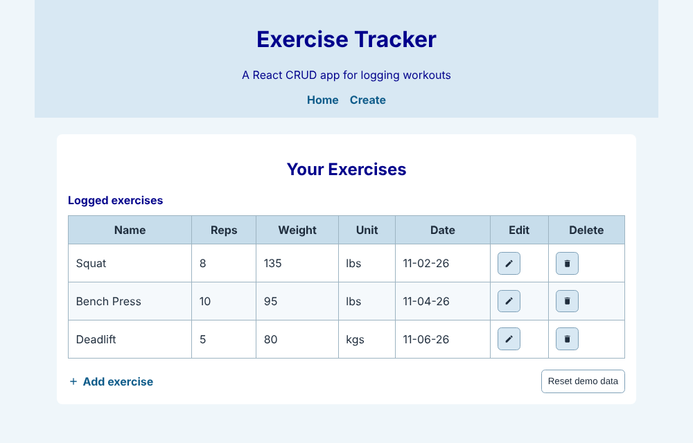

# Exercise Tracker

A React single-page app for logging workouts: create, view, edit and delete exercises (name, reps, weight, unit and date).

**Live demo:** https://MICAH-OSU.github.io/exercise-tracker/ <!-- update after the first deploy -->



## Background

I first built this for Assignment 9 in **CS 290 (Web Development) at Oregon State University**. The original was a full MERN stack app: a React front end calling an Express REST API backed by MongoDB.

This repository has both halves:

- **`server/`**: the original Express + MongoDB REST API (`GET`/`POST /exercises`, `GET`/`PUT`/`DELETE /exercises/:id`) with request validation.
- **`src/`**: a rebuilt React front end with two interchangeable data layers. `exercises.local.js` stores records in the browser's `localStorage`, so the live demo runs on GitHub Pages with no server. `exercises.rest.js` calls the Express API. Both expose the same functions, and `vite.config.js` picks one at build time.

## Features

- List, add, edit and delete exercises
- Input validation with clear error messages (required fields, positive whole numbers, lbs/kgs)
- Edit pages have their own URL (`#/edit/<id>`), so refreshing keeps your place
- Data persists between visits in the same browser; **Reset demo data** restores the sample rows
- Accessible labels on icon buttons and form fields, and a table that scrolls on small screens

## Changes from the course version

| Area | Course version | This version |
|---|---|---|
| Data | Express + MongoDB REST API only | Same API, plus a `localStorage` mode for the static demo |
| Routing | `react-router` with `BrowserRouter` | Small hash router (works on static hosting) |
| Edit page | Exercise passed in router state, lost on refresh | Loaded by id from the URL |
| Forms | Create and Edit duplicated the same markup | Shared `ExerciseForm` component |
| Dates | Free-text `MM-DD-YY` | Date picker; displayed as `MM-DD-YY` |
| Feedback | `alert()` pop-ups | Inline status and error messages |
| Accessibility | Icon button labels rendered literally (`'Edit ${exercise.name}'`) | Labels include the exercise name |

## Tech

React 18, Vite, react-icons, Node.js, Express, MongoDB with Mongoose, GitHub Actions for deployment.

## Run locally

**Browser-only (no database needed):**

```bash
npm install
npm run dev
```

Then open the URL Vite prints (usually http://localhost:5173).

**Full stack (React + Express + MongoDB):**

1. Set up the API:
   ```bash
   cd server
   npm install
   cp .env.example .env    # then put your MongoDB connection string in .env
   npm start               # API on http://localhost:3000
   ```
2. In another terminal, from the project root:
   ```bash
   npm run dev:api         # Vite proxies /exercises to the API
   ```

`server/.env` holds your database credentials and is excluded by `.gitignore`; never commit it.

## Deploy

Pushing to `main` runs `.github/workflows/deploy.yml`, which builds the site and publishes it to GitHub Pages. One-time setup: in the repository, go to **Settings → Pages** and set **Source** to **GitHub Actions**.

## Project structure

```
server/
  exercises_controller.mjs  Express routes and request validation
  exercises_model.mjs       Mongoose schema and database functions
src/
  api/exercises.local.js  data layer for the static demo (localStorage)
  api/exercises.rest.js   data layer for the Express API (converts dates to MM-DD-YY)
  api/validate.js         shared validation rules
  components/             layout, navigation, table, row, shared form
  pages/                  Home, Create, Edit, Not Found
  router.jsx              hash-based routing
  format.js               date display helper
```

## Credits

The API in `server/` is my CS 290 Assignment 9 work (Oregon State University). The front-end rebuild, local data layer and deployment setup were developed with help from Claude (Anthropic).
